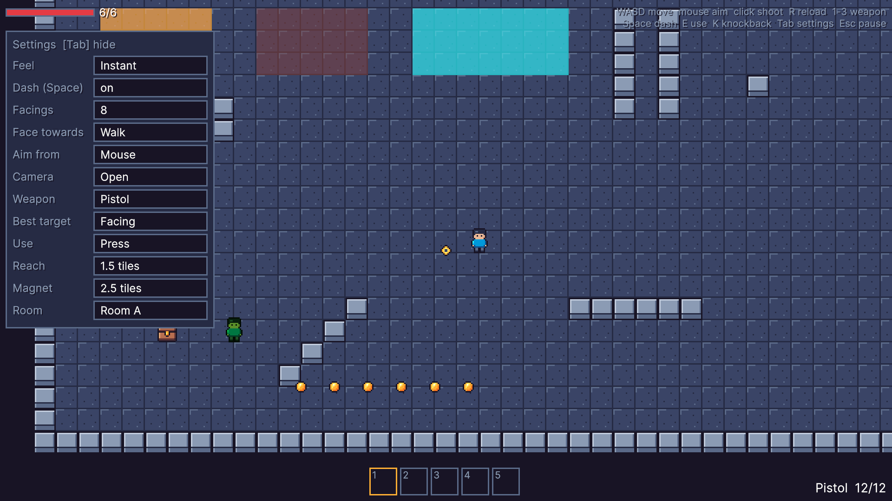
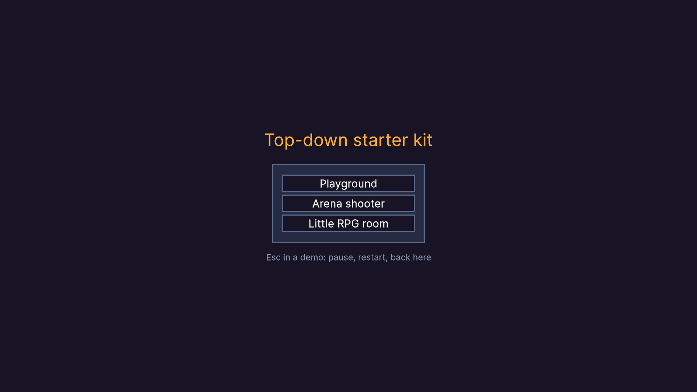

# Base 2D Movement Engine

A reusable **top-down 2D starter kit** for Unity 6 (URP 2D, pixel art). It is not one
game: it gives a game movement, facing, aiming, a camera with rooms, combat, interaction,
pickups and an inventory, and lets each game pick how they feel through **settings**
instead of code changes. Each game adds its own rules on top.

## What you can choose

The rule behind the kit: *a difference in how games feel is a setting; a feature only
some games need is an optional add-on piece.*

| System | Choices |
|---|---|
| **Movement** | 8 directions. Feel from instant to glide: speed, time to full speed, time to stop (assets `Instant`, `Glide`, `Ice`, `Heavy`). Add-ons: dash (exact distance), speed zones (scale speed or swap the feel), knockback and recoil. |
| **Facing and aim** | 4 or 8 facings. Face where you walk or where you aim. Aim from the mouse or from walking. Art is 5 drawings + mirroring, or true 8. |
| **Camera** | Open follow, rooms that slide, or rooms that fade. Whole-pixel movement, screen shake. Add-ons: room locks (doors close until cleared), warps. |
| **Combat** | Weapon assets (fire rate, automatic, spread, bullets per shot, speed, range, damage, knockback, recoil, magazine, reload, shake). Pooled bullets, health with teams and invulnerable time, damage with knockback. Enemy brains: chase, keep distance and shoot, wander. Add-on: room waves. |
| **Interaction** | One key uses the best nearby target (closest or the one you face), press or hold, adjustable reach. NPC text boxes, locked doors, levers. |
| **Pickups and inventory** | Automatic or manual pickups, a magnet with adjustable range. A bag with a hotbar; chests use the same inventory. |
| **Screens** | HUD (health, ammo, hotbar, status, banner, help - each optional), pause menu, start menu. UI Toolkit, scaled with the pixel camera. |

## Demos

Open `Assets/Scenes/StartMenu.unity` and press Play. It leads to:

- **Arena shooter** - rooms that lock until each wave is cleared.
- **Little RPG** - talk, open chests, collect coins, use a lever and a locked door.
- **Playground** - every system at once. Press **Tab** to switch any setting live.

| Arena shooter | Little RPG | Start menu |
|---|---|---|
|  |  |  |

## Controls

| Key | Action |
|---|---|
| WASD | Move |
| Mouse | Aim |
| Left click | Shoot |
| R | Reload |
| 1-3 / wheel | Switch weapon (shooter) |
| 1-5 | Hotbar slot (RPG) |
| Q | Drop item |
| Space | Dash |
| E | Use / talk / open |
| Tab | Settings panel (Playground) |
| K | Knock the player back from the mouse (Playground) |
| Esc | Pause |

Keyboard and mouse only for now. Input reaches the rules as data (a move direction, an
aim direction), so touch sticks can drive the same code later.

## Starting a game from the kit

1. Copy this project (or the `Assets/Scripts` folder and the `Assets/Data` assets you need).
2. Start from the Playground scene, or a demo close to your game.
3. Pick a movement feel, facing, camera layout and weapons in the inspector - or make new
   `MoveFeel` and `Weapon` assets for your own feel.
4. Add only the add-ons your game needs (dash, room locks, waves, magnet...).
5. Replace the placeholder art. Gameplay numbers are in tiles (16 px = 1 tile), so art
   size and style can change without retuning.
6. Write your game's own rules on top. Don't add "if this game, do X" inside the kit.

## How it is built

- **Fixed 60 Hz step** for movement, bullets and damage, so it feels the same at any
  frame rate.
- **One copy of each core rule** (movement, damage, knockback, inventory, best target),
  shared by the player, enemies and tests.
- **Pixel perfect**: 640x360 base resolution, whole-number scaling to 720p-4K.
- **Measured, not guessed**: `Tools/measure/` holds scripts that drive the real game in
  play mode and check movement, dash distance and knockback at 30 vs 144 fps, combat,
  bullet allocations, camera pixels, inventory rules, UI scale, and full bot playthroughs
  of both demos.

## Folders

| Folder | What is there |
|---|---|
| `Assets/Scripts/` | Kit code by system: `Movement`, `Facing`, `Camera`, `Combat`, `Interaction`, `Inventory`, `Screens`, `Playground` |
| `Assets/Data/` | Movement feels, weapons, items, dialogue |
| `Assets/Prefabs/` | Enemies |
| `Assets/Scenes/` | `StartMenu`, `ArenaShooter`, `LittleRpg`, `Playground` |
| `Assets/Art/` | Placeholder pixel art and the one palette (Endesga 32) |
| `Tools/measure/` | The measuring harness |
| `Tools/pxkit/` | Code-drawn placeholder sprites |
| `Docs/` | Roadmap and notes |

## Requirements

- Unity **6000.3** (made with 6000.3.23f1)
- Universal Render Pipeline **17.3** with the 2D Renderer
- Input System package (the old input manager is off)
- Windows (PC) is the tested target. Android and iOS are planned.

## Licence

Free to use and change for your own games, including games you sell. You may not
re-upload, redistribute or sell the kit itself, or claim it as your own. See
[LICENSE](LICENSE).

Made by [mark-tetelea](https://github.com/mark-tetelea).
