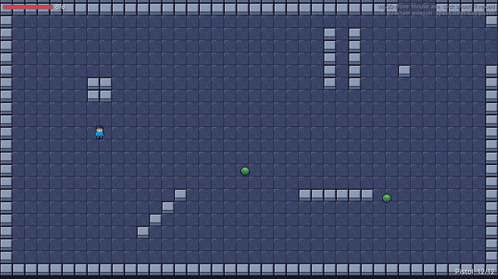
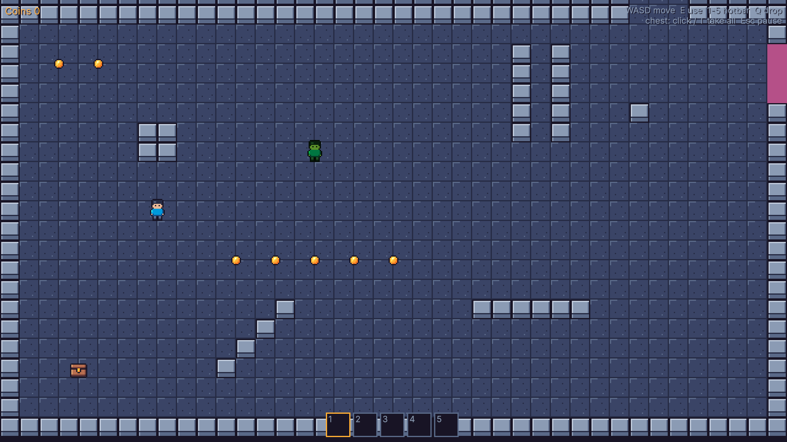

# Base 2D Movement Engine

A reusable **top-down 2D starter kit** for Unity 6 (URP 2D, pixel art). It is not one
game: it gives a game movement, facing, aiming, a camera with rooms, combat, interaction,
pickups and an inventory, and lets each game pick how they feel through **settings**
instead of code changes. Each game adds its own rules on top.

## What you can choose

The rule behind the kit: *a difference in how games feel is a setting; a feature only
some games need is an optional add-on piece.*

| System | Choices |
|---|---|
| **Movement** | 8 directions. Feel from instant to glide: speed, time to full speed, time to stop (assets `Instant`, `Glide`, `Ice`, `Heavy`). Add-ons: dash (exact distance), speed zones (scale speed or swap the feel), knockback and recoil. |
| **Facing and aim** | 4 or 8 facings. Face where you walk or where you aim. Aim from the mouse or from walking. Art is 5 drawings + mirroring, or true 8. |
| **Camera** | Open follow, rooms that slide, or rooms that fade. Whole-pixel movement, screen shake. Add-ons: room locks (doors close until cleared), warps. |
| **Combat** | Weapon assets (fire rate, automatic, spread, bullets per shot, speed, range, damage, knockback, recoil, magazine, reload, shake). Pooled bullets, health with teams and invulnerable time, damage with knockback. Enemy brains: chase, keep distance and shoot, wander. Add-on: room waves. |
| **Interaction** | One key uses the best nearby target (closest or the one you face), press or hold, adjustable reach. NPC text boxes, locked doors, levers. |
| **Pickups and inventory** | Per item: walk onto it, press use, or a magnet. A bag with a hotbar; chests and shops use the same inventory. Anything can be dropped. |
| **Screens** | HUD (health, ammo, hotbar, status, banner, boss bar, help - each optional), pause menu with a rebind screen, start menu, map, touch controls. UI Toolkit, scaled with the pixel camera. Look (colours, font - a pixel font included - box art, layout) from one theme asset. |

## Demos

Open `Assets/Scenes/StartMenu.unity` and press Play. It leads to:

- **Arena shooter** - rooms that lock until each wave is cleared.
- **Little RPG** - talk, open chests, collect coins, use a lever and a locked door.
- **Playground** - every system at once. Press **Tab** to switch any setting live.
- **Dungeon** - a new level of rooms every run, crates, a boss at the end.

| Arena shooter | Little RPG | Start menu |
|---|---|---|
|  |  |  |

## Controls

| Key | Action |
|---|---|
| WASD / arrows | Move |
| Mouse | Aim |
| Left click | Shoot |
| R | Reload |
| 1-9 / wheel | Weapon or hotbar slot |
| Q | Drop item |
| I | Bag |
| T | Take all (chest) |
| Space | Dash |
| E | Use / talk / open |
| M | Map |
| Tab | Settings panel (Playground) |
| K | Knock the player back from the mouse (Playground) |
| Esc | Pause |

**Every key is a setting.** The defaults live in `Assets/Resources/KitControls.asset` (change a
key there, no code). Players change them in game: **Esc > Controls**, click a key, press the new
one (Backspace clears, Esc cancels). Their changes are kept by the Save add-on. Touch buttons
press the same controls, so rebinding and touch never touch the game rules.

## Starting a game from the kit

1. Copy this project (or the `Assets/Scripts` folders and the `Assets/Data` assets you need).
2. Start from the Playground scene, or a demo close to your game.
3. Pick a movement feel, facing, camera layout and weapons in the inspector - or make new
   `MoveFeel` and `Weapon` assets for your own feel.
4. Delete the systems you don't need (below). Delete `Assets/Scripts/Demos` once you have your own scenes.
5. Replace the placeholder art, sounds and UI look (below). Gameplay numbers are in tiles
   (16 px = 1 tile), so art size and style can change without retuning.
6. Write your game's own rules on top. Don't add "if this game, do X" inside the kit.

## Replace or remove a system

Each system is a folder under `Assets/Scripts` with its own assembly definition, so it only
sees the folders it lists. **Core** (`Core`, `Movement`, `Facing`, `Camera`, `Screens`) is what
everything stands on and stays. Every other folder can be deleted. Some take their users with
them (the table says which); everything left still compiles - checked by
**TopDownKit > Check removable systems** (or `sh Tools/measure/removal-check.sh`), which
compiles the kit without each system in turn. After deleting, remove the dead components from
your scenes (Unity shows them as "Missing script") and the system's rows from `KitControls`.

| System | Replace (no code) | Remove |
|---|---|---|
| **Controls** (`Core`) | Keys: `Resources/KitControls`. Add a row for your own action and read it with `Controls.Pressed("Cast")`. | Core - stays. |
| **Movement** | Feel: a `MoveFeel` asset (`Assets/Data/Movement`). Grid step, step time, dash distance are settings. | Core - stays. |
| **Facing and animation** | Character art: a **Sprite Animations** asset (Create > TopDownKit > Sprite Animations) on the object's `DirectionalSprites`. Any action (Idle, Walk, Dash, Attack, Hurt, Death, or your own name), any number of frames, any frame rate, one entry for every facing or one per facing; Mirror Left on = 5 drawings + flipping, off = true 8. Works on enemies too (it faces the way they move). Example: `Assets/Data/Art/PlayerAnims`. | Core - stays. |
| **Camera** | Layout (open / rooms slide / rooms fade) and shake are settings on `CameraRig`. | Core - stays. |
| **Screens** (HUD, pause, rebind screen, start menu) | Look: `Resources/KitTheme` (a **UI Theme** asset): colours, font, box / button / slot / bar sprites (9-sliced), sizes, where each HUD part sits. Pixel font: point the theme at `Assets/UI/Fonts/KitPixel` (font asset) with Pixel Font Size 8, or copy `Assets/UI/KitThemePixel`. Extra styling: USS classes `kit-box`, `kit-button`, `kit-label`, `kit-slot`, `kit-bar`, `hud-*` in `Assets/UI/KitTheme.tss`. | Core - stays. |
| **Combat** | Weapons: `Weapon` assets (bullet sprite and colour, swing sprite). Enemies: prefabs in `Assets/Prefabs/Enemies` - swap the sprite or add `DirectionalSprites`. | Takes Enemies, Tiles, World and the Arena, Dungeon and Playground demos. Pickups, the map, saving, sounds and touch keep working (they talk to it through small promises in `Core/Contracts.cs`). |
| **Interaction** | NPC lines: `DialogueLines` assets. Prompt key art: `InteractPrompt` sprite. | Takes Inventory, Save, Shop, World and the RPG, Dungeon and Playground demos. |
| **Inventory** (items, bag, hotbar, chests, key doors) | Items: `Item` assets (icon, stack size, pickup mode; **Floor Prefab** for its own look on the floor). Chest art: open / closed sprites on the `Chest`. | Takes Save, Shop, World and the RPG, Dungeon and Playground demos. |
| **Tiles** (ground rules, trails) | A new kind of ground = a new `GroundTile` asset (art + rules) in `Assets/Data/Tiles`. Walls are ordinary tilemap tiles: paint your own. | Takes World and the Dungeon demo. Enemy paths then stop avoiding hurting ground. |
| **Enemies** (brains, paths, boss, groups) | Behaviour, weapon and feel are settings on the prefab; boss phases on `BossPhases`. | Alone. |
| **World** (generated levels, crates, drop tables) | Rooms: `RoomPiece` prefabs in `Assets/Prefabs/Rooms`. Crate: `Assets/Prefabs/World/Crate`. Drops: the `Drops` table. | Takes the Dungeon demo. |
| **Feel** (sounds, effects, hit-stop, day/night) | Sounds: `Assets/Data/Feel/KitFeel` - one slot per event (clips, volume, effect prefab, hit-stop). One object's own sounds: `FeelOverride`. Effects: any prefab in a slot (`Burst` has a bit sprite). Music: the set's music clip. Every event reaches it through `Cues` - no clip is set in code. | Alone: the game is silent. |
| **Save** | Which parts are saved and how many slots: settings on `SaveGame`. | Alone: no saving; key changes last until the game closes. |
| **Shop** | Stock: `ShopStock` assets. | Alone. |
| **Map** | Corner / full / off, what shows: settings on `Minimap`. Colours: the UI theme. | Alone. |
| **Touch** | Sticks and buttons: settings on `TouchControls`. Colours: the UI theme. | Alone. |
| **Demos** (`Arena`, `Rpg`, `Dungeon`, `Playground`) | - | Each alone. Delete them all for your own game. |

## How it is built

- **Fixed 60 Hz step** for movement, bullets and damage, so it feels the same at any
  frame rate.
- **One copy of each core rule** (movement, damage, knockback, inventory, best target),
  shared by the player, enemies and tests.
- **Input as data**: keys become a move direction, an aim and controls by name (`Controls`);
  touch presses the same controls. The rules never read a key.
- **Pixel perfect**: 640x360 base resolution, whole-number scaling to 720p-4K.
- **Removable systems**: one assembly definition per folder; systems that would otherwise
  need each other meet in `Assets/Scripts/Core` (controls, `Cues` for sounds, small contracts).
- **Measured, not guessed**: `Tools/measure/` holds scripts that drive the real game in
  play mode and check movement, dash distance and knockback at 30 vs 144 fps, combat,
  bullet allocations, camera pixels, inventory rules, UI scale, saving, full bot
  playthroughs of the demos, and that every optional system can be removed.

## Folders

| Folder | What is there |
|---|---|
| `Assets/Scripts/` | Kit code, one folder per system (table above); `Demos/` holds the demos' own rules |
| `Assets/Editor/` | The removable-systems check |
| `Assets/Resources/` | `KitControls` (keys), `KitTheme` (UI look), `KitPanel` (UI panel) |
| `Assets/Data/` | Movement feels, weapons, items, tiles, dialogue, shops, sounds, animations |
| `Assets/Prefabs/` | Enemies, room pieces, crate, pickups, effects |
| `Assets/Scenes/` | `StartMenu`, `ArenaShooter`, `LittleRpg`, `Playground`, `Dungeon` |
| `Assets/Art/`, `Assets/Audio/`, `Assets/UI/` | Placeholder art, sounds, UI style and the pixel font |
| `Tools/measure/` | The measuring harness |
| `Tools/pxkit/`, `Tools/sfx/`, `Tools/font/` | Code-drawn placeholder sprites, sounds and the pixel font |
| `Docs/` | Roadmap and notes |

## Requirements

- Unity **6000.3** (made with 6000.3.23f1)
- Universal Render Pipeline **17.3** with the 2D Renderer
- Input System package (the old input manager is off)
- Windows (PC) is the tested target. Android and iOS are planned.

## Licence

Free to use and change for your own games, including games you sell. You may not
re-upload, redistribute or sell the kit itself, or claim it as your own. See
[LICENSE](LICENSE).

Made by [mark-tetelea](https://github.com/mark-tetelea).
